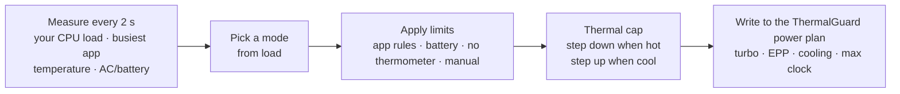

# ThermalGuard

Keeps a Windows laptop cool and quiet without giving up speed when you need it.

ThermalGuard sits in the system tray and switches the CPU between three modes
every couple of seconds, based on what you are actually doing:

| Mode | When | What it does |
|---|---|---|
| **Quiet** (green shield) | browsing, documents, idle | turbo off, efficiency-biased, slows the CPU before spinning fans up |
| **Balanced** (blue shield) | sustained work, or one busy app (single-threaded CAD, compiles) | turbo on |
| **Performance** (orange shield) | heavy all-core load | aggressive turbo |

On top of that it **caps the CPU clock step by step when the CPU gets hot**
and releases the cap gradually once it has cooled down.

It only changes processor settings in its own power plan (a copy of Balanced
called "ThermalGuard"), so your other plans are never modified. Exiting from
the tray menu switches back to the plan you had before.

## The tray icon

The shield's colour is the current mode; red on the shield means the CPU
clock is being capped because the CPU is hot.

| Icon | Meaning |
|:---:|---|
|  | **Quiet** — light or no work. Turbo off, fans stay low. |
|  | **Balanced** — you're working (sustained load, or one app keeping a core busy). Turbo on. |
|  | **Performance** — heavy all-core work (renders, builds, simulations). Aggressive turbo. |
|    | **Same modes, capped** — red rim and red thermometer: the CPU passed the "hot" temperature and its maximum clock is limited until it cools down. Normal under long heavy load; if you see it while doing little, check what's running. |

Hover the icon for the details: mode, `(manual)` if you picked a mode
yourself, the current cap (e.g. `cap 3.8 GHz`), CPU temperature and your load.
Versions 1.0.0–1.0.1 showed a coloured circle with a letter instead
(green **Q**, blue **B**, orange **P**, red ring = capped); same meaning.

## How it works

The goal: **full speed when you're working, silence when you're not, and
never cooking the CPU.** A laptop's own firmware only reacts once it's
already hot — it slams the clock down at ~100 °C, the fans scream, and
performance becomes erratic. ThermalGuard decides every 2 seconds from what
is actually happening, and stays ahead of that point.



### 1. Measuring — what counts as "your work"

- **Your load** = total CPU use **minus background services** (Windows
  Search, Defender, updates, OneDrive, vendor agents… see `background_apps`).
  Those still run, just without earning turbo — that's what used to make an
  idle laptop's fans spin up.
- **Busiest app** in cores (1.0 = one core fully busy). Single-threaded work
  like CAD or a compiler step is only ~8 % of total CPU on a 12-thread chip,
  but it still deserves turbo — so this is tracked separately.
- **Temperature** from LibreHardwareMonitor or HWiNFO, **power source**, and
  Windows' own throttling counters.

Load is smoothed with **medians over 15 s and 60 s**, so opening an app or a
two-second spike doesn't count as work — load has to last for about half the
window.

### 2. Choosing the mode — with hysteresis

| Switch | When |
|---|---|
| → **Performance** | your load ≥ 60 % (15 s median) |
| Performance → Balanced | load < 40 % on *both* the 15 s and 60 s medians, after ≥ 20 s in Performance |
| → **Balanced** | load ≥ 25 %, **or** the busiest app uses ≥ 0.8 cores |
| Balanced → Quiet | load < 18 % and busiest app < 0.6 cores on both medians, after ≥ 20 s in Balanced |

The "up" thresholds are higher than the "down" ones, and a mode is only left
downwards after at least 20 s, so it doesn't flap between modes on a
borderline load. Going up is quick (about 8 s of sustained load); coming down
waits until the work has clearly ended.

Then a few limits are applied, in this order:

1. **App rules** (`app_min_modes`) can raise the floor, e.g. keep Balanced
   while a CAD program is open.
2. **On battery** it never goes above `battery_max_mode` (Balanced), and
   leans further towards efficiency.
3. **No temperature reading?** It stays at Balanced at most — without a
   thermometer it can't catch overheating early, so it doesn't risk
   aggressive turbo.
4. A mode you pick in the tray menu overrides everything.

### 3. What each mode changes

| | Quiet | Balanced | Performance |
|---|---|---|---|
| Turbo boost | off | on | aggressive |
| Energy preference (0 = speed, 100 = efficiency) | 70 | 40 | 15 |
| Cooling policy | passive (slow the CPU before spinning fans) | active (fans first) | active |

On battery the energy preference gets +20. All of this is in
[config.py](config.py) and can be changed in `config.json`.

### 4. The thermal cap — staying just below "too hot"

Instead of letting the CPU hit its limit and crash its clock, ThermalGuard
lowers the **maximum clock in steps** — 4.2 → 3.8 → 3.4 → 3.0 → 2.6 GHz —
and finds the highest speed the cooler can sustain:

- **≥ 90 °C** (`hot_c`): one step down, at most every 10 s, while it stays hot.
- **≥ 97 °C** (`critical_c`): straight to the lowest step.
- **78–90 °C**: hold the current step — this is the sweet spot.
- **≤ 78 °C** (`cool_c`) for 30 s: one step back up, then the next after
  another 30 s cool.
- While capped, the cooling policy is forced to *active*, so fans help.

The gap between 78 and 90 °C keeps it from oscillating, and the
one-step-at-a-time release means it settles at the fastest clock your
laptop can hold rather than bouncing between flat out and throttled.

**Without a temperature source** it uses indirect signals instead: Windows'
throttling counters (3 readings in a row under real load) and *heat soak* —
5 minutes of ≥ 70 % load triggers a pre-emptive step. These signals can be
wrong, so in this mode it caps at most two steps (3.8 GHz).

### 5. Applying it

The result is written to ThermalGuard's own power plan (turbo mode, energy
preference, cooling policy, maximum frequency) only when something changed,
and the plan is re-activated if something else switched plans. Everything it
decides is in the log (tray → **Open log**), each change with its reason, e.g.
`-> balanced, capped at 3800 MHz (active work (41%, busiest app 1.2 cores))`.

### Why not just use the Windows power slider?

The slider is static: "Best performance" runs hot and loud while you read
email; "Best power efficiency" is sluggish when you compile. Background
services (search indexing, antivirus scans, updates, vendor agents) also
trigger turbo and fan noise. ThermalGuard ignores those — only *your* apps
decide the mode (see `background_apps` below).

## Install

1. Download `ThermalGuard-Setup-x.y.z.exe` from
   [Releases](https://github.com/siddharthsingh-chauhan/ThermalGuard/releases).
2. Run it. The installer isn't code-signed, so Windows SmartScreen may say
   "Windows protected your PC" — click **More info → Run anyway**.
3. Optional checkboxes during setup:
   - **Install LibreHardwareMonitor** — recommended. ThermalGuard needs a CPU
     temperature for Performance mode and for heat-based caps; without one it
     stays at Balanced at most and only reacts to Windows' own throttling
     counters. Uses `winget`, so it needs internet.
   - **Hibernate on lid close (battery) and power button** — stops a laptop
     from cooking itself in a bag. See [Lid and power button](#lid-and-power-button).

ThermalGuard starts at every logon through a Task Scheduler task (it needs
admin rights to change power settings, and a task is the only way to start
elevated without a UAC prompt each time).

Requirements: Windows 10 or 11, 64-bit. Built and tested on an Intel laptop;
AMD should work since it only uses standard Windows power settings.

### Verify your download

Every installer is built by GitHub Actions from the code in this repository
(see [the workflow](.github/workflows/release.yml)), and each
[release](https://github.com/siddharthsingh-chauhan/ThermalGuard/releases)
lists its SHA-256 checksum and a VirusTotal scan link. To check the file you
downloaded:

```powershell
Get-FileHash .\ThermalGuard-Setup-1.0.3.exe
```

The hash must match the one in the release notes.

**Uninstall:** Settings → Apps → ThermalGuard. This removes the logon task and
the ThermalGuard power plan and switches back to the plan you used before
ThermalGuard (Balanced if that plan no longer exists). Your settings and logs in
`%LOCALAPPDATA%\ThermalGuard` are kept; LibreHardwareMonitor and lid/power
button settings are left as they are.

## Tray menu

- **Automatic** (default) or a fixed **Quiet / Balanced / Performance**
- **Open log** — every mode change with the reason, plus a status line every 30 s
- **Edit settings** — opens `config.json`; changes apply within a few seconds
- **Exit** — restores your previous power plan

## Temperature sources

Tried in order, first one with a CPU temperature wins:

1. **LibreHardwareMonitor** web server (`Options → Remote Web Server → Run`,
   port 8085). The installer option sets this up.
2. **HWiNFO** shared memory (`Settings → Shared Memory Support`). Note the free
   version switches shared memory off after 12 hours.

## Settings

`%LOCALAPPDATA%\ThermalGuard\config.json` — only include the keys you want to
change; everything else uses the defaults in [config.py](config.py).

| Key | Default | Meaning |
|---|---|---|
| `battery_max_mode` | `"balanced"` | highest mode on battery (`"quiet"` = coolest) |
| `battery_epp_offset` | `20` | extra efficiency bias on battery (0–100 scale) |
| `load.balanced_up_pct` | `25` | total CPU % (your apps) that switches to Balanced |
| `load.performance_up_pct` | `60` | total CPU % that switches to Performance |
| `load.single_thread_up_cores` | `0.8` | one app using this many cores → Balanced |
| `thermal.hot_c` / `cool_c` | `90` / `78` | start capping / start releasing (°C) |
| `thermal.critical_c` | `97` | jump straight to the lowest cap |
| `thermal.freq_caps_mhz` | `[4200, 3800, 3400, 3000, 2600]` | cap steps; set to suit your CPU's max turbo |
| `thermal.no_temp_max_mode` | `"balanced"` | highest mode while no temperature is available |
| `app_min_modes` | `{}` | e.g. `{"SLDWORKS.exe": "balanced"}` keeps turbo while that app is open |
| `background_apps` | indexer, Defender, updates, vendor agents… | names or wildcards whose CPU use doesn't count |
| `lhm_url` | `http://127.0.0.1:8085/data.json` | `""` to skip LibreHardwareMonitor |

Example:

```json
{
  "battery_max_mode": "quiet",
  "app_min_modes": {"blender.exe": "performance"}
}
```

## Lid and power button

`Set-LidPolicy.ps1` (in `C:\Program Files\ThermalGuard\scripts`) sets what the
lid and power button do, in **every** power plan. Run it in an admin PowerShell:

```powershell
& "C:\Program Files\ThermalGuard\scripts\Set-LidPolicy.ps1" -OnBattery Hibernate -PluggedIn Nothing -PowerButton Hibernate
```

| Parameter | Values | Default |
|---|---|---|
| `-OnBattery` | lid close on battery: `Sleep`, `Hibernate`, `Keep` | `Hibernate` |
| `-PluggedIn` | lid close plugged in: `Sleep`, `Hibernate`, `Nothing`, `Keep` | `Keep` |
| `-PowerButton` | `Sleep`, `Hibernate`, `ShutDown`, `Keep` | `Hibernate` |
| `-HibernateAfterMin` | on battery, sleep becomes hibernate after N minutes | unchanged |

`Nothing` when plugged in keeps external monitors running with the lid shut.

### If your laptop runs hot while "asleep" or "off"

Things found while building this, worth checking on any laptop:

- **Modern Standby** (`powercfg /a` says "Standby (S0 Low Power Idle)") can stay
  awake in a bag if a device blocks deep sleep. `powercfg /sleepstudy` shows how
  much each sleep session drained. Hibernate avoids the problem entirely.
- **Fast Startup** makes "Shut down" a partial hibernate; if that hangs, the
  laptop stays on with the screen off. Event Viewer → System → Kernel-Power 41
  after a shutdown is the tell. Turn it off in Control Panel → Power Options →
  Choose what the power buttons do.
- **Wake-armed devices**: `powercfg /devicequery wake_armed`.

## Build from source

Needs Python 3.11 (64-bit), and [Inno Setup 6](https://jrsoftware.org/isinfo.php)
for the installer (`winget install JRSoftware.InnoSetup`).

```powershell
.\build.ps1          # tests, then dist\ThermalGuard\ and dist\ThermalGuard-Setup-<version>.exe
```

Without Inno Setup you still get `dist\ThermalGuard\`; `install.ps1` (admin)
installs that folder directly. Run unpackaged with
`python app.py --console --dry-run` to watch decisions without changing anything.

Releases: bump `version.py`, then push a tag `v<version>` — GitHub Actions
builds the installer and attaches it to a release.

## Privacy

This program will not transfer any information to other networked systems
unless specifically requested by the user or the person installing or
operating it. ThermalGuard only reads sensor data from LibreHardwareMonitor on
the same PC (`http://127.0.0.1:8085`). The optional LibreHardwareMonitor setup
downloads that program with `winget` when you tick it in the installer.

## Code signing policy

Releases are currently **not code-signed** (hence the SmartScreen warning).
ThermalGuard is applying for free code signing from
[SignPath.io](https://about.signpath.io) with a certificate by
[SignPath Foundation](https://signpath.org). Once that is in place, only
installers built by GitHub Actions from this repository will be signed, each
after manual approval by the approver below.

- Committers and reviewers: [siddharthsingh-chauhan](https://github.com/siddharthsingh-chauhan)
- Approvers: [siddharthsingh-chauhan](https://github.com/siddharthsingh-chauhan)

## License

MIT — see [LICENSE](LICENSE). No warranty: ThermalGuard changes Windows power
settings; uninstalling switches back to the power plan you used before.
